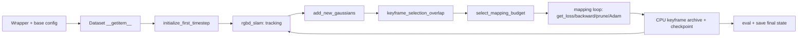
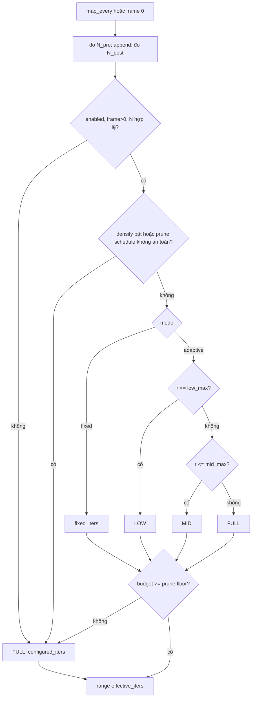
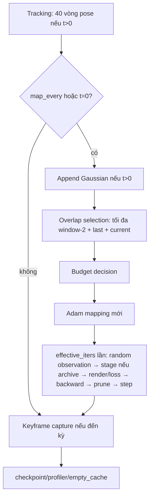
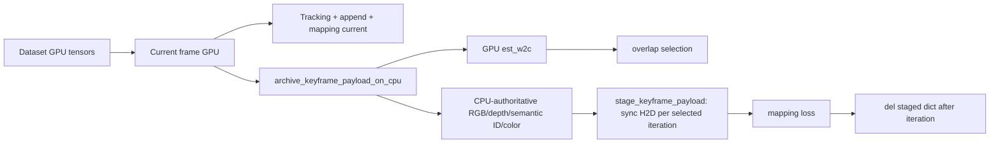
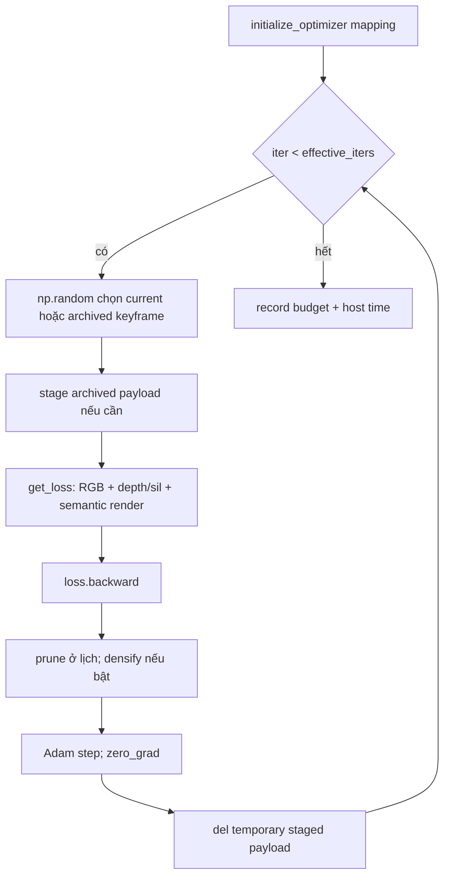

# Phase 6 — kiểm toán kỹ thuật source, cấu hình, luồng dữ liệu và chứng cứ

Ngày kiểm toán: 2026-10-20. Phạm vi: đọc tĩnh source/config/Git và đọc các artifact đã lưu; **không chạy SLAM, CUDA, evaluator hay benchmark**. Nhãn: `VERIFIED_SOURCE` = truy được đường chạy; `VERIFIED_CONFIG` = định nghĩa, nạp và read-site; `VERIFIED_ARTIFACT` = giá trị trong artifact hiện có; `INFERRED` = hệ quả kỹ thuật chưa đo tách biệt; `NOT_VERIFIED` = thiếu phép đo/chứng cứ; `NOT_IMPLEMENTED` = không có đường chạy đã xác nhận. Dẫn chiếu `:Lx-Ly` là dòng của working tree tại HEAD khi kiểm toán; với run lịch sử phải dùng commit và snapshot nêu riêng.

## 1. Tóm tắt Phase 6

**Kết luận.** Tên phương pháp trong lịch sử dự án là **Budget-Aware Mapping (BAM)**; implementation cụ thể là bộ điều khiển số vòng mapping theo *tỷ lệ Gaussian mới thêm* (novelty-aware tiered iteration budget). Bộ điều khiển quyết định `effective_iters` cho **mỗi mapping event**, không đặt trần Gaussian, không sửa tracking, keyframe policy hay loss. V-A2 dùng LOW/MID/FULL = 45/60/60 với ngưỡng 0,01/0,05 và tối đa cấu hình 60; khi tín hiệu/điều kiện không hợp lệ, chạy đủ 60. `VERIFIED_SOURCE` [utils/mapping_budget.py:L45-L114](../../../utils/mapping_budget.py); [scripts/slam.py:L979-L1052](../../../scripts/slam.py). Tên/phạm vi thiết kế được ghi ở [P6-BAM-001 implementation report](P6_BAM_001_IMPLEMENTATION_REPORT.md), nhưng chứng cứ implementation là source.

Phase 6 chạy trên nền **Phase 4 CPU keyframe offload**: payload keyframe lưu chủ đạo ở CPU, bản GPU được stage đồng bộ theo iteration được chọn. `VERIFIED_SOURCE` [scripts/slam.py:L534-L575](../../../scripts/slam.py), [scripts/slam.py:L1054-L1083](../../../scripts/slam.py), [scripts/slam.py:L1180-L1198](../../../scripts/slam.py). Kết quả matched 0–499 room0 cho thấy ít hơn 7.305 vòng mapping và online-loop wall thấp hơn 15,33%; peak allocated cao hơn ở V-A2, nên **không có bằng chứng BAM trực tiếp tiết kiệm peak VRAM**. `VERIFIED_ARTIFACT` [P6-BAM-005 comparison](P6_BAM_005_0_499_COMPARISON.md), [V0 telemetry](../../../results/runtime_artifacts/phase6_bam/telemetry/p6_bam_005_room0_0_499_v0_r01/telemetry_summary.json), [V-A2 telemetry](../../../results/runtime_artifacts/phase6_bam/telemetry/p6_bam_005_room0_0_499_va2_r01/telemetry_summary.json).

**Trạng thái Git.** Branch `phase5-profiling-instrumentation`, HEAD `75d9b7302adeb871308e8105246bb1b95cd804a5`. Working tree đã bẩn trước kiểm toán: sáu file project-state/management tracked bị sửa và nhiều file chưa theo dõi, gồm hồ sơ room1; không coi chúng là thay đổi của audit. Phần source BAM bắt đầu tại `e644df4`, sửa tên biến event tại `a3aefc7`; Phase 4 offload có từ `8061093`, nhánh tham chiếu `phase4-vb-001-cpu-keyframe-offload` tại `37522db`. `VERIFIED_ARTIFACT` Git history; [PROJECT_STATUS](../../../project_management/PROJECT_STATUS.md), [SESSION_HANDOFF](../../../project_management/SESSION_HANDOFF.md), [DEC-017](../../../project_management/DECISIONS.md). Các tài liệu `docs/repository_understanding/` là audit baseline tại `e418398`, không phải xác nhận trực tiếp code Phase 6.

## 2. Kiến trúc hệ thống

`scripts/slam.py:rgbd_slam` là online entry point. `SourceFileLoader` nạp wrapper thí nghiệm, đặt seed, sao chép config; `rgbd_slam` ghi `effective_config.json`, khởi tạo dataset và map rồi xử lý từng frame. Dataset trả RGB/depth/pose/semantic lên `primary_device`; first frame tạo Gaussian; mỗi frame theo dõi pose, có thể thêm Gaussian, chọn cửa sổ keyframe, quyết định ngân sách, tối ưu map, lưu keyframe và checkpoint. Đánh giá cuối chạy qua `utils/eval_helpers.py:eval`; post-opt là chế độ khác và không nằm trong Phase 6 này. `VERIFIED_SOURCE` [scripts/slam.py:L1299-L1321](../../../scripts/slam.py), [scripts/slam.py:L578-L687](../../../scripts/slam.py), [scripts/slam.py:L812-L841](../../../scripts/slam.py), [scripts/slam.py:L1249-L1293](../../../scripts/slam.py).

Các cạnh tương ứng [scripts/slam.py:L668-L715](../../../scripts/slam.py), [scripts/slam.py:L858-L980](../../../scripts/slam.py), [scripts/slam.py:L984-L1052](../../../scripts/slam.py), [scripts/slam.py:L1084-L1127](../../../scripts/slam.py), [scripts/slam.py:L1180-L1204](../../../scripts/slam.py), [scripts/slam.py:L1273-L1293](../../../scripts/slam.py).

**Ranh giới thuật toán.** Tracking cập nhật pose camera hiện tại với Adam và map LR bằng 0; mapping cập nhật Gaussian với camera LR bằng 0. `get_loss` dùng `transform_to_frame` với `gaussians_grad=False,camera_grad=True` cho tracking và ngược lại cho mapping; nhánh `do_ba` hiện có nhưng caller online không truyền `True`. `VERIFIED_SOURCE` [scripts/slam.py:L184-L190](../../../scripts/slam.py), [scripts/slam.py:L259-L275](../../../scripts/slam.py), [configs/replica/slam.py:L61-L105](../../../configs/replica/slam.py), [scripts/slam.py:L876-L883](../../../scripts/slam.py), [scripts/slam.py:L1084-L1090](../../../scripts/slam.py). Semantic là `semantic_colors` trainable N×3, `semantic_ids` cố định; pass raster semantic riêng, loss RGB/depth/semantic. `VERIFIED_SOURCE` [scripts/slam.py:L153-L181](../../../scripts/slam.py), [scripts/slam.py:L277-L351](../../../scripts/slam.py).

## 3. Thuật toán Phase 6

Đặt `N_pre = means3D.shape[0]` trước append, `N_post` sau append và `r=(N_post−N_pre)/N_pre`. Số vòng `B_t` (đơn vị **iteration của một mapping event**, không phải số keyframe hay ngân sách thời gian): frame 0 hoặc fallback → 60; V-A2 hợp lệ: `r≤0,01 → 45`, `0,01<r≤0,05 → 60`, `r>0,05 → 60`. V-A cũ dùng 30/45/60; V0 tắt controller và chạy 60; `V-FIXED30/45` có wrapper nhưng `NOT_VERIFIED` là đã chạy ablation P6-BAM-004. `VERIFIED_SOURCE` [utils/mapping_budget.py:L45-L114](../../../utils/mapping_budget.py); `VERIFIED_CONFIG` [configs/replica/phase6_bam_va.py:L7-L12](../../../configs/replica/phase6_bam_va.py), [configs/replica/phase6_bam_va2.py:L11-L16](../../../configs/replica/phase6_bam_va2.py), [configs/replica/phase6_bam_v0.py:L6-L7](../../../configs/replica/phase6_bam_v0.py), [configs/replica/phase6_bam_vfixed45.py:L6-L7](../../../configs/replica/phase6_bam_vfixed45.py).

`VERIFIED_SOURCE` [scripts/slam.py:L979-L1041](../../../scripts/slam.py), [utils/mapping_budget.py:L27-L42](../../../utils/mapping_budget.py), [utils/mapping_budget.py:L45-L114](../../../utils/mapping_budget.py). Controller kiểm tra integer dương, ngưỡng hữu hạn, thứ tự tier, `full == configured_iters`, trần `budget≤configured_iters`; prune schedule tính iteration cuối cần giữ. Với config đang xét, prune ở index 0 và 20, nên floor là **21**. Nếu gradient clone/split densification bật hoặc reset opacity của prune bật/không hợp lệ, fallback FULL. Không có feedback từ wall time, overlap, PSNR/loss, trạng thái keyframe, FPS hay VRAM. `VERIFIED_SOURCE` [utils/mapping_budget.py:L27-L42](../../../utils/mapping_budget.py), [utils/mapping_budget.py:L67-L113](../../../utils/mapping_budget.py); `VERIFIED_CONFIG` [configs/replica/slam.py:L107-L129](../../../configs/replica/slam.py).

Mapping event diễn ra ở frame 0 hoặc mỗi `map_every` frame; keyframe archive được thêm **sau** mapping theo `keyframe_every=5`, cộng frame áp chót. Vì vậy "keyframe mới" không kích hoạt ngân sách riêng; controller không đọc `keyframe_every` và quyết định trước khi lưu keyframe hiện tại. Non-keyframe vẫn được mapping khi `map_every=1`, và current frame luôn là một phần tử cửa sổ chọn (`-1`). `VERIFIED_SOURCE` [scripts/slam.py:L979-L980](../../../scripts/slam.py), [scripts/slam.py:L1017-L1033](../../../scripts/slam.py), [scripts/slam.py:L1180-L1198](../../../scripts/slam.py); `VERIFIED_CONFIG` [configs/replica/slam.py:L12-L16](../../../configs/replica/slam.py).

Giảm iteration cắt bớt các lần chọn observation, H2D (nếu chọn keyframe cũ), 3 pass render, loss, backward, prune-call và optimizer step ở đuôi vòng lặp; **không bỏ** tracking, dataset load, append, overlap selection, khởi tạo Adam, keyframe archive, checkpoint, end-frame cache, final evaluation. Prune thực sự đến index 20 vẫn được giữ; clone/split densify tắt trong các snapshot Phase 6. Gaussian count có thể đổi gián tiếp qua số bước tối ưu và quyết định prune/append tương lai; không có trần số Gaussian trực tiếp. `VERIFIED_SOURCE` [scripts/slam.py:L984-L1044](../../../scripts/slam.py), [scripts/slam.py:L1052-L1160](../../../scripts/slam.py), [scripts/slam.py:L1180-L1213](../../../scripts/slam.py), [utils/slam_external.py:L179-L255](../../../utils/slam_external.py).

`VERIFIED_SOURCE` [scripts/slam.py:L858-L944](../../../scripts/slam.py), [scripts/slam.py:L979-L1127](../../../scripts/slam.py), [scripts/slam.py:L1180-L1213](../../../scripts/slam.py).

## 4. Triển khai source code và call graph

| Chức năng; caller → callee | Input → output; điều kiện; mutation/bộ nhớ | Bằng chứng |
|---|---|---|
| `rgbd_slam` → `select_mapping_budget` | `config,N_pre,N_post,frame,prune_dict` → immutable decision; mỗi mapping event; CPU scalar; không đổi map | `VERIFIED_SOURCE` [scripts/slam.py:L979-L1041](../../../scripts/slam.py), [utils/mapping_budget.py:L11-L20](../../../utils/mapping_budget.py) |
| `select_mapping_budget` → `_required_prune_iterations` | prune schedule → floor hoặc invalid; CPU; fallback FULL | `VERIFIED_SOURCE` [utils/mapping_budget.py:L27-L42](../../../utils/mapping_budget.py), [utils/mapping_budget.py:L73-L113](../../../utils/mapping_budget.py) |
| `rgbd_slam` → `add_new_gaussians` → `get_pointcloud`/`initialize_new_params` | depth/silhouette/current pose → nối Gaussian, reset auxiliaries; GPU; trước budget | `VERIFIED_SOURCE` [scripts/slam.py:L442-L499](../../../scripts/slam.py), [scripts/slam.py:L984-L1002](../../../scripts/slam.py) |
| `rgbd_slam` → `keyframe_selection_overlap` → `get_pointcloud` | depth, intrinsics, w2c, archive poses → indices; GPU projection, sample 1600 pixels, sau đó random permutation; payload CPU không stage | `VERIFIED_SOURCE` [scripts/slam.py:L1010-L1033](../../../scripts/slam.py), [utils/keyframe_selection.py:L10-L110](../../../utils/keyframe_selection.py) |
| `rgbd_slam` → `stage_keyframe_payload` | archived RGB/depth/ID/color CPU → temporary GPU; mỗi selected archived observation; synchronous `non_blocking=False`; del sau iteration | `VERIFIED_SOURCE` [scripts/slam.py:L555-L575](../../../scripts/slam.py), [scripts/slam.py:L1059-L1083](../../../scripts/slam.py), [scripts/slam.py:L1139-L1140](../../../scripts/slam.py) |
| `rgbd_slam` → `get_loss` → transform/render helpers → external rasterizer | Gaussian+pose+frame → RGB/depth/silhouette/semantic render, weighted loss; GPU graph; tracking vs mapping detach flags | `VERIFIED_SOURCE` [scripts/slam.py:L252-L351](../../../scripts/slam.py), [utils/slam_helpers.py:L119-L247](../../../utils/slam_helpers.py) |
| `rgbd_slam` → `prune_gaussians`/`densify` | parameters, auxiliaries, Adam state → filtered/clone/split map; GPU; densify branch tắt ở shipped online config | `VERIFIED_SOURCE` [scripts/slam.py:L1103-L1127](../../../scripts/slam.py), [utils/slam_external.py:L127-L255](../../../utils/slam_external.py) |
| `rgbd_slam` → `record_mapping_budget`/profiler | decision, actual iterations → scalar telemetry; chỉ khi profiler bật; không điều khiển thuật toán | `VERIFIED_SOURCE` [scripts/slam.py:L1148-L1159](../../../scripts/slam.py), [utils/mapping_budget.py:L127-L149](../../../utils/mapping_budget.py) |
| `rgbd_slam` → `archive_keyframe_payload_on_cpu` | payload GPU → detached CPU copy, `est_w2c` vẫn GPU; `keyframe_list` dài dần | `VERIFIED_SOURCE` [scripts/slam.py:L534-L552](../../../scripts/slam.py), [scripts/slam.py:L1180-L1198](../../../scripts/slam.py) |

`keyframe_selection_overlap` chỉ xét hình học/projection; khối semantic-mIoU còn comment, `NOT_IMPLEMENTED` trong active online path [utils/keyframe_selection.py:L64-L110](../../../utils/keyframe_selection.py). `uncertainty` được tạo và detach trong `get_loss` nhưng không dùng làm trọng số loss tại đoạn tính loss, `NOT_IMPLEMENTED` như mô tả phương pháp paper [scripts/slam.py:L297-L351](../../../scripts/slam.py). `post_slam_opt.py` và họ `gs_*` là chế độ khác, không tham gia call graph online này; `VERIFIED_SOURCE` [scripts/slam.py:L35-L47](../../../scripts/slam.py).

So với Phase 4 (`8061093`), commit `e644df4` thêm controller và wrapper, `a3aefc7` tách tên configured/effective theo event, còn `36284a2` thêm timer host cho 0–499 và `b946322` thêm checkpoint-first finalization cho full scene. Đó là thay đổi đo/độ an toàn output, không phải đổi quy tắc BAM. `VERIFIED_ARTIFACT` Git read-only history; `VERIFIED_SOURCE` [scripts/slam.py:L812-L816](../../../scripts/slam.py), [scripts/slam.py:L1215-L1216](../../../scripts/slam.py), [scripts/slam.py:L1249-L1293](../../../scripts/slam.py).

## 5. Luồng dữ liệu và bộ nhớ

`BaseDataset.__getitem__` đọc RGB/semantic color dạng float, depth/ID dạng integer ban đầu; RGB resize bilinear, depth/ID/semantic color nearest; depth chia `png_depth_scale`; intrinsics scale theo resize, pose tương đối frame đầu; trả tensors trên `self.device` (config CUDA). `VERIFIED_SOURCE` [datasets/gradslam_datasets/basedataset.py:L174-L210](../../../datasets/gradslam_datasets/basedataset.py), [datasets/gradslam_datasets/basedataset.py:L222-L317](../../../datasets/gradslam_datasets/basedataset.py), [datasets/gradslam_datasets/basedataset.py:L357-L406](../../../datasets/gradslam_datasets/basedataset.py). `rgbd_slam` đổi HWC→CHW, RGB/semantic màu chia 255, giữ semantic ID nguyên, dùng w2c = inverse(relative c2w). `VERIFIED_SOURCE` [scripts/slam.py:L668-L684](../../../scripts/slam.py), [scripts/slam.py:L819-L840](../../../scripts/slam.py).

| Bước | Tạo/tái dùng, vị trí và điều kiện | Thay đổi Phase 6 |
|---|---|---|
| Frame load | RGB/depth/semantic/pose mới mỗi frame trên GPU; intrinsics và camera setup tái dùng; dataset đọc lại trong final eval | Không đổi; [scripts/slam.py:L817-L853](../../../scripts/slam.py), [utils/eval_helpers.py:L607-L640](../../../utils/eval_helpers.py) |
| Tracking | `tracking_curr_data`, Adam mới, rendered images/graph, pose tốt nhất; t>0; 40 vòng danh nghĩa, có thể nhân đôi khi depth threshold bật | Không đổi; [scripts/slam.py:L854-L959](../../../scripts/slam.py) |
| Append | depth/silhouette render, mask, pointcloud, `torch.cat` map, reset arrays GPU; mapping event t>0 | Tạo `N_post` signal sau append; [scripts/slam.py:L442-L499](../../../scripts/slam.py), [scripts/slam.py:L981-L1002](../../../scripts/slam.py) |
| Overlap | 1600 depth samples, reprojection qua `est_w2c` GPU, indices CPU/Python list; luôn thêm last và current | Không đổi số lượng/cách chọn; [utils/keyframe_selection.py:L40-L110](../../../utils/keyframe_selection.py), [scripts/slam.py:L1017-L1033](../../../scripts/slam.py) |
| Mapping | Random trong window; current GPU hoặc archive CPU→GPU; 3 raster passes, loss, backward, prune và Adam; optimizer mới mỗi event | Chỉ số lần lặp `range(effective_iters)`; [scripts/slam.py:L1037-L1145](../../../scripts/slam.py) |
| Capture/output | Copy payload keyframe sang CPU, giữ pose GPU; checkpoint định kỳ; final eval, NPZ/PLY | BAM không đổi lịch keyframe/eval; checkpoint-first là cờ full-scene; [scripts/slam.py:L1180-L1213](../../../scripts/slam.py), [scripts/slam.py:L1249-L1293](../../../scripts/slam.py) |

`VERIFIED_SOURCE` [scripts/slam.py:L534-L575](../../../scripts/slam.py), [scripts/slam.py:L1017-L1033](../../../scripts/slam.py), [scripts/slam.py:L1059-L1140](../../../scripts/slam.py). Không có pinned memory, async copy, prefetch hay persistent GPU cache trong các hàm này. Archive vẫn tăng theo số keyframe; BAM giảm kỳ vọng **số lần** H2D vì ít iteration, không giảm kích thước một keyframe.

`VERIFIED_SOURCE` [scripts/slam.py:L1043-L1160](../../../scripts/slam.py). Phân bổ VRAM chính: map parameters, gradient và Adam moments, auxiliary per-Gaussian, renderer buffers/graph, current frame, staged observation, append/prune transient copies; allocator cache có thể giữ `reserved` sau khi live tensors giải phóng. `INFERRED` từ [scripts/slam.py:L136-L190](../../../scripts/slam.py), [scripts/slam.py:L442-L499](../../../scripts/slam.py), [scripts/slam.py:L1059-L1140](../../../scripts/slam.py), [utils/slam_external.py:L147-L200](../../../utils/slam_external.py). Không có per-stage reset peak, nên vị trí chính xác của global peak là `NOT_VERIFIED`.

## 6. Cấu hình thực thi

Chuỗi nạp: `slam.py` ở CLI nạp wrapper bằng `SourceFileLoader`; `phase6_bam_base.py` nạp và deep-copy `configs/replica/slam.py`, ép output riêng, budget flag và profiling mặc định off; wrapper/run gate override; `rgbd_slam` bổ sung tracking defaults, ghi `effective_config.json` trước dataset defaults, sau đó đọc tại các branch. `VERIFIED_SOURCE` [scripts/slam.py:L578-L594](../../../scripts/slam.py), [scripts/slam.py:L630-L684](../../../scripts/slam.py), [scripts/slam.py:L1299-L1321](../../../scripts/slam.py); `VERIFIED_CONFIG` [configs/replica/phase6_bam_base.py:L13-L40](../../../configs/replica/phase6_bam_base.py). Vì snapshot được ghi trước vài default dataset trong source, snapshot không nhất thiết phản ánh mọi field sau mutation; room1 pre-run expected serialization thiếu ba inactive/default fields so với effective snapshot được báo ở [room1 Gate 5 report](../../../docs/experiments/PHASE6_MULTISCENE_ROOM1_GATE5_FINAL_REPORT.md). Dùng actual effective snapshot, không suy từ wrapper một mình.

| Parameter | Baseline released / Phase 4 | Phase 6 V0 | Phase 6 V-A / V-A2 full | Read-site và tác dụng |
|---|---|---|---|---|
| `map_every` | 1 / 1 | 1 | 1 | mapping event mỗi frame [scripts/slam.py:L979-L980](../../../scripts/slam.py) |
| `keyframe_every`, window | 5, 24 / giữ | giữ | giữ | capture và overlap window; không là novelty signal [scripts/slam.py:L1017-L1030](../../../scripts/slam.py), [scripts/slam.py:L1180-L1198](../../../scripts/slam.py) |
| `tracking.num_iters` | 40 / giữ | 40 | 40 | tracking while loop [scripts/slam.py:L868-L938](../../../scripts/slam.py) |
| `mapping.num_iters` | 60 / giữ | 60 | 60 | configured ceiling; `eval` cũng nhận 60, không nhận effective per-frame [scripts/slam.py:L1037-L1041](../../../scripts/slam.py), [scripts/slam.py:L1280-L1288](../../../scripts/slam.py) |
| `budget_control` | không khai báo / không khai báo | `{enabled:false}` | V-A 30/45/60; V-A2 45/60/60, 0,01/0,05 | controller fallback/tiers [utils/mapping_budget.py:L48-L114](../../../utils/mapping_budget.py) |
| `add_new_gaussians`, prune, gradient densify | true, true, false / giữ | giữ | giữ | append trước decision; prune floor 21; densify false [scripts/slam.py:L984-L1002](../../../scripts/slam.py), [scripts/slam.py:L1103-L1116](../../../scripts/slam.py) |
| semantics; resolution; seed | true; 680×1200; 0 / giữ | giữ | giữ; room0/room1 scene override | loader/render/loss [configs/replica/slam.py:L48-L59](../../../configs/replica/slam.py), [scripts/slam.py:L662-L684](../../../scripts/slam.py) |
| `profiling.mode` | Phase 4 tùy run / Phase 5 thêm | LIGHT trong các matched runs | LIGHT trong các runs được đối chiếu | profiler, scalar budget, allocator sample [scripts/slam.py:L612-L628](../../../scripts/slam.py), [scripts/slam.py:L1148-L1150](../../../scripts/slam.py) |
| `checkpoint_first_finalization` | absent | absent | true full-scene room0/room1 | save/validate trước eval, ngoài online loop [scripts/slam.py:L1249-L1293](../../../scripts/slam.py) |

Giá trị baseline/Phase 4 lấy từ [configs/replica/slam.py:L8-L130](../../../configs/replica/slam.py) và hồ sơ [Phase 4 closure](../../../docs/experiments/PHASE4_VB001_EVALUATION_RESULT.md); effective V-A2 full room0 [snapshot](../../../results/runtime_artifacts/phase6_bam/p6_bam_006_room0_0_1999_va2_r01/effective_config.json); room1 [wrapper](../../../configs/replica/phase6_bam_room1_gate3_full_0_1999_r01.py), [snapshot](../../../results/runtime_artifacts/phase6_bam/p6_bam_ms_room1_gate3_0_1999_r01/effective_config.json). Snapshot bounded 0–499 nằm ở [V0](../../../results/runtime_artifacts/phase6_bam/p6_bam_005_comparison/v0_effective_config.json) và [V-A2](../../../results/runtime_artifacts/phase6_bam/p6_bam_005_comparison/va2_effective_config.json). Không điền giá trị riêng của run Phase 4 nếu không có snapshot tương ứng. Các option `use_uncertainty_for_loss`, `use_chamfer`, BA không được BAM kích hoạt qua read-site online đã kiểm tra; `NOT_IMPLEMENTED` cho đường BAM.

**Provenance source theo run.** P6-BAM-002: `a3aefc7`; 003 V0/V-A: `bb830b1`; 003-R1 V-A2: `60372fc` với wrapper còn untracked theo metadata; 005 V0/V-A2: `937cd4b` nhưng metadata ghi `M scripts/slam.py` (timer measurement-only), nên **commit đơn lẻ không đóng băng đầy đủ byte source**; xem frozen manifests/snapshot kèm cặp; 006 room0 và room1: frozen `002927f3b24dd69418c17da08bd4ae987bae9ee2`, room1 chạy từ worktree riêng. `VERIFIED_ARTIFACT` metadata dưới [telemetry](../../../results/runtime_artifacts/phase6_bam/telemetry/), [P6-BAM-005 comparison](P6_BAM_005_0_499_COMPARISON.md), [room1 report](../../../docs/experiments/PHASE6_MULTISCENE_ROOM1_GATE5_FINAL_REPORT.md). HEAD hiện tại là hậu nghiệm documentation descendant, không được gọi là source của mọi kết quả.

## 7. Runtime và VRAM

Chi phí bị cắt trực tiếp là các iteration mapping. Append, overlap selection, keyframe capture, tracking và final eval vẫn chạy theo lịch cũ; mỗi mapping iteration còn có random selection, H2D đồng bộ khi chọn archive, ba raster passes, backward và Adam. Vì vậy tỷ lệ giảm tổng thời gian không thể bằng tỷ lệ giảm iteration; chi phí renderer phụ thuộc số Gaussian/scene và thời điểm, profiling host spans có thể lồng nhau. `VERIFIED_SOURCE` [scripts/slam.py:L979-L1160](../../../scripts/slam.py), [scripts/slam.py:L1278-L1293](../../../scripts/slam.py). Timer online 0–499/006 đặt quanh frame loop, loại init/eval/save; `/usr/bin/time` bao cả process. `VERIFIED_SOURCE` [scripts/slam.py:L812-L816](../../../scripts/slam.py), [scripts/slam.py:L1215-L1216](../../../scripts/slam.py); `VERIFIED_ARTIFACT` [005 comparison](P6_BAM_005_0_499_COMPARISON.md), [006 runtime](../../../results/runtime_artifacts/phase6_bam/p6_bam_006_comparison/runtime_fps.json).

| Phạm vi room0 | V0 | V-A2 | Diễn giải |
|---|---:|---:|---|
| 0–499 mapping iterations | 30.000 | 22.695 | −24,35%, matched pair; [005 comparison](P6_BAM_005_0_499_COMPARISON.md) |
| 0–499 mapping host span | 1.355,20 s | 1.004,94 s | −25,85%; cùng LIGHT protocol |
| 0–499 online loop wall | 2.319,05 s | 1.963,46 s | −15,33%; 1 cặp, không ước lượng biến thiên |
| 0–499 process wall | 2.349,67 s | 1.994,25 s | −15,13%; gồm eval/save |
| 0–499 PyTorch peak allocated | 3.597.379.072 B | 3.777.924.096 B | **cao hơn** với V-A2; không chứng minh giảm peak VRAM |
| 0–499 PyTorch peak reserved | 4.661.968.896 B | 4.582.277.120 B | thấp hơn nhẹ, allocator cache, không là device-wide peak |
| 0–499 archive logical | 2.663.424.000 B | 2.663.424.000 B | cùng 102 keyframes |
| 0–499 H2D events | 27.938 | 21.099 | giảm theo iteration; không đo riêng latency H2D |

Các số allocator/H2D/archive lấy trực tiếp từ [005 V0 telemetry](../../../results/runtime_artifacts/phase6_bam/telemetry/p6_bam_005_room0_0_499_v0_r01/telemetry_summary.json) và [005 V-A2 telemetry](../../../results/runtime_artifacts/phase6_bam/telemetry/p6_bam_005_room0_0_499_va2_r01/telemetry_summary.json), hoặc 005 comparison. `torch.cuda.memory_allocated()` là live allocator bytes tại lúc sample; `memory_reserved()` là khối allocator đang giữ; `max_memory_allocated()`/`max_memory_reserved()` là high-water kể từ khởi tạo/reset (run này không reset ở stage); `nvidia-smi` đo device-wide/process ngoài allocator và không có chuỗi peak hợp lệ cho matched 005. `VERIFIED_SOURCE` [utils/performance_profiler.py:L496-L520](../../../utils/performance_profiler.py); `VERIFIED_ARTIFACT` [005 comparison](P6_BAM_005_0_499_COMPARISON.md). LIGHT sample ở cuối frame, có thể bỏ qua transient; high-water counters bắt transient nhưng không định vị stage. `NOT_VERIFIED` peak thuộc append, mapping, tracking hay evaluation; profiler kết thúc sau eval, nhưng memory samples chỉ trong frame loop và high-water được ghi lúc sample trước eval [scripts/slam.py:L1210-L1213](../../../scripts/slam.py), [scripts/slam.py:L1278-L1293](../../../scripts/slam.py).

Room0 full V-A2: 90.195/120.000 iterations (−24,8375% so với *all-60 arithmetic reference*, **không phải matched full V0**), online wall 12.383,451 s, process wall 12.766,4 s, evaluation 369,807 s; PyTorch high-water allocated/reserved 7.443.113.472/8.227.127.296 B; peak process RSS `/usr/bin/time` 17.627.216 KiB; archive 10.497.024.000 logical B, H2D 85.969 events/2.244.822.528.000 cumulative B. `VERIFIED_ARTIFACT` [006 execution](../../../results/runtime_artifacts/phase6_bam/p6_bam_006_comparison/execution_result.json), [006 runtime](../../../results/runtime_artifacts/phase6_bam/p6_bam_006_comparison/runtime_fps.json), [006 memory](../../../results/runtime_artifacts/phase6_bam/p6_bam_006_comparison/memory_archive_h2d.json). Room1 full V-A2: 90.840/120.000, process wall 16.075,75 s, online loop 15.695,987 s, allocated/reserved 10.223.109.632/12.513.705.984 B, process peak RSS 19.119.360 KiB; H2D 86.479 events. `VERIFIED_ARTIFACT` [room1 Gate 5 report](../../../docs/experiments/PHASE6_MULTISCENE_ROOM1_GATE5_FINAL_REPORT.md), [room1 telemetry](../../../results/runtime_artifacts/phase6_bam/telemetry/p6_bam_ms_room1_gate3_0_1999_r01/telemetry_summary.json). Room1 khác scene, **NOT DIRECTLY COMPARABLE** với room0 về speed/VRAM.

## 8. So sánh Baseline, Phase 4 và Phase 6

| Thuộc tính | Baseline released | Phase 4 VB-001 | Phase 6 V-A2 |
|---|---|---|---|
| Thay đổi trực tiếp | Không | Payload keyframe CPU-authoritative, H2D theo nhu cầu | Số iteration mapping theo novelty; kế thừa offload |
| Resident keyframes | GPU payload | CPU payload; GPU pose | Như Phase 4 |
| Tracking, overlap policy, loss | Released | Giữ | Giữ; BAM chỉ đổi `range` mapping |
| Map growth/densification | Pixel append + prune; gradient densify off | Giữ | Giữ trực tiếp; diễn tiến Gaussian có thể khác gián tiếp |
| Full room0 | Baseline OOM frame 1294 trên RTX 5080 | 2.000 frames, 4.956.467 final Gaussian, 402 keyframes | 2.000 frames, 5.004.577 final Gaussian, 402 keyframes |
| Runtime full-scene | Không hoàn tất | 14.173,475 s output-save process | 12.766,4 s process; **NOT DIRECTLY COMPARABLE** với Phase 4 vì timing/instrumentation boundary khác, không có matched full V0 |
| Peak memory | Trước OOM 13.602.712.064/15.843.983.360 B allocated/reserved | 5.817.509.888/7.189.037.056 B output-save run | 7.443.113.472/8.227.127.296 B; **NOT DIRECTLY COMPARABLE** xuyên run |

Chứng cứ Phase 4/baseline: [PROJECT_STATUS](../../../project_management/PROJECT_STATUS.md), [Phase 4 closure](../../../results/runtime_artifacts/phase4_closure/), [Phase 4 E4 evaluation](../../../docs/experiments/PHASE4_VB001_EVALUATION_RESULT.md). Chứng cứ Phase 6: [006 execution](../../../results/runtime_artifacts/phase6_bam/p6_bam_006_comparison/execution_result.json), [006 memory](../../../results/runtime_artifacts/phase6_bam/p6_bam_006_comparison/memory_archive_h2d.json). So sánh hợp lệ mạnh nhất về runtime là **005 V0/V-A2 cùng room0 0–499, cùng RTX 5080, seed, resolution, evaluator và LIGHT**, khác budget flag; provenance source có uncommitted timer nên phải kèm run manifests. `VERIFIED_ARTIFACT` [005 comparison](P6_BAM_005_0_499_COMPARISON.md).

Chất lượng room0 full theo E4 401 sampled views và 2.000 poses: Phase 4 → Phase 6 lần lượt PSNR 33,313067→32,944552 dB; MS-SSIM 0,979470→0,978004; LPIPS-Alex 0,067555→0,070752; Depth L1 0,004952→0,004943 m; semantic-color mIoU 0,916585→0,913531; ATE mean 0,002741→0,002844 m; true ATE RMSE 0,003398→0,003437 m. Cả bảy qua screen 15% do nghiên cứu định nghĩa, **không phải kiểm định tương đương thống kê**. `VERIFIED_ARTIFACT` [006 quality comparison](../../../results/runtime_artifacts/phase6_bam/p6_bam_006_comparison/phase4_quality_comparison.json), [006 aggregate](../../../results/runtime_artifacts/phase6_bam/p6_bam_006_comparison/aggregate_quality_metrics.json), [006 trajectory](../../../results/runtime_artifacts/phase6_bam/p6_bam_006_comparison/trajectory_metrics.json). Tên `Depth RMSE` trong released evaluator tính mean `sqrt(error²)` = MAE; `SSIM` dùng `ms_ssim`; semantic-color mIoU dùng GT palette-assisted recoloring, không phải direct ID prediction; ATE released là mean sau Horn alignment, không phải RMSE. `VERIFIED_SOURCE` [utils/eval_helpers.py:L59-L180](../../../utils/eval_helpers.py), [utils/eval_helpers.py:L582-L710](../../../utils/eval_helpers.py).

Trong matched 005, final-map 11 views `[0,49,...,499]`, ATE 500 poses: V0→V-A2 PSNR 36,19163→36,12453; MS-SSIM 0,989386→0,988725; LPIPS 0,051610→0,050332; Depth L1 0,00312353→0,00320590 m; semantic mIoU 0,908787→0,907979; ATE mean 0,00254617→0,00230700 m; RMSE 0,00308668→0,00281463 m. `VERIFIED_ARTIFACT` [005 comparison](P6_BAM_005_0_499_COMPARISON.md), [005 paired validation](../../../results/runtime_artifacts/phase6_bam/p6_bam_005_comparison/paired_validation.json). Không cộng hoặc gộp các metric này với room0 full/room1.

## 9. Gate và thí nghiệm

| Gate/run | Trạng thái và chứng cứ | Giới hạn |
|---|---|---|
| P6-BAM-001/FIX1 | CPU/static tests và controller; [implementation](P6_BAM_001_IMPLEMENTATION_REPORT.md), [FIX1](P6_BAM_001_FIX1_REPORT.md) | Chưa runtime tại gate này |
| P6-BAM-002, room0 0–10 V0/V-A | 660/660 so 420/660; adaptive activation, CPU archive/H2D; [smoke](P6_BAM_002_SMOKE_REPORT.md), [comparison](P6_BAM_002_COMPARISON.md), [telemetry](../../../results/runtime_artifacts/phase6_bam/telemetry/) | 11 frames; không chứng minh quality/speedup full |
| P6-BAM-003, room0 0–49 V0/V-A | 3.000 vs 1.740; **INCONCLUSIVE** do PSNR/depth và runtime criteria; [report](P6_BAM_003_0_49_REPORT.md), [comparison](P6_BAM_003_0_49_COMPARISON.md), [artifacts](../../../results/runtime_artifacts/phase6_bam/p6_bam_003_comparison/) | Một cặp, 50 frames |
| P6-BAM-003-R1, room0 0–49 V-A2 | 2.445/3.000; 1 FULL/12 MID/37 LOW; 15% screen pass vs saved V0; [report](P6_BAM_003_R1_VA2_REPORT.md), [comparison](P6_BAM_003_R1_VA2_COMPARISON.md) | PSNR −0,50164 dB vượt biên lịch sử 0,5 dB rất nhỏ; single run |
| P6-BAM-004 fixed ablation | `PLANNED_NOT_STARTED`; [PROJECT_STATUS](../../../project_management/PROJECT_STATUS.md), wrapper [fixed30](../../../configs/replica/phase6_bam_vfixed30.py)/[fixed45](../../../configs/replica/phase6_bam_vfixed45.py) | `NOT_VERIFIED` có runtime run; không kết luận adaptive hơn fixed-45 |
| P6-BAM-005, room0 0–499 V0/V-A2 | matched LIGHT pair, 30.000 vs 22.695, online −15,33%, 15% quality screen pass; [report](P6_BAM_005_0_499_REPORT.md), [comparison](P6_BAM_005_0_499_COMPARISON.md), [artifacts](../../../results/runtime_artifacts/phase6_bam/p6_bam_005_comparison/) | Không đạt mục tiêu lịch sử ≥20% online; 1 pair |
| P6-BAM-006, room0 0–1999 V-A2 | full scene single run, 90.195 iterations, 5.004.577 Gaussian, 402 keyframes, 401 E4 views, quality screen pass, visualization RGB/semantic; [report](P6_BAM_006_FULL_SCENE_REPORT.md), [execution](../../../results/runtime_artifacts/phase6_bam/p6_bam_006_comparison/execution_result.json), [manifest](../../../results/runtime_artifacts/phase6_bam/p6_bam_006_comparison/artifact_manifest.json) | Không có matched full V0; runtime speedup unverified |
| P6-BAM-007, qualitative/publication | Gate 0–3 PASS; Gate 4 PASS_WITH_LIMITATIONS; Gate 5A/B/C PASS, thesis figures and backup package; [Gate 3](P6_BAM_007_GATE3_THESIS_PACKAGING_REPORT.md), [Gate 4](../../../results/runtime_artifacts/phase6_bam/p6_bam_007_qualitative_comparison/gate4_scientific_validation/GATE4_SCIENTIFIC_VALIDATION_REPORT.md), [Gate 5C](../../../results/runtime_artifacts/phase6_bam/p6_bam_007_qualitative_comparison/gate5c_final_closure/run_01/GATE5C_FINAL_REPORT.md) | Presentation/validation gate, không thêm SLAM result |
| Replica room1 Gate 1→2→3/4→5 | Gate 1 bounded 0–49, Gate 2 0–99, Gate 3 full 0–1999; Gate 4 model PASS, Gate 5 saved-state eval PASS, overall `ROOM1_GATE5_CLOSED_QUALIFIED`; [Gate 1](../../../docs/experiments/PHASE6_MULTISCENE_ROOM1_GATE1_REPORT.md), [Gate 2](../../../docs/experiments/PHASE6_MULTISCENE_ROOM1_GATE2_REPORT.md), [Gate 5](../../../docs/experiments/PHASE6_MULTISCENE_ROOM1_GATE5_FINAL_REPORT.md) | Không có matched room1 V0; room2 chỉ planned |

Room1 full: frozen worktree source `002927f3`, 2.000 frames, 6.682.135 Gaussian, 402 keyframes, 401 saved-state views, PSNR **34,096186 dB**, MS-SSIM **0,971436**, LPIPS-Alex **0,091352**, Depth L1 **0,0043937 m**, semantic-color mIoU **0,926535**, ATE mean **0,00465533 m**, true RMSE **0,00480202 m**, process FPS **0,124411**. `VERIFIED_ARTIFACT` [room1 aggregate](../../../results/runtime_artifacts/phase6_bam/evaluation/p6_bam_ms_room1_gate3_0_1999_r01_offline/aggregate_metrics.json), [room1 trajectory](../../../results/runtime_artifacts/phase6_bam/evaluation/p6_bam_ms_room1_gate3_0_1999_r01_offline/trajectory_metrics.json), [room1 Gate 5](../../../docs/experiments/PHASE6_MULTISCENE_ROOM1_GATE5_FINAL_REPORT.md). Gate 5 offline riêng không có wall timer; NVML peak không đo; CUDA-event timing vẫn chưa được xác thực. Visualization 3D semantic PLY là learned semantic color, không phải per-pixel class predictor. `VERIFIED_ARTIFACT` [room1 Gate 5](../../../docs/experiments/PHASE6_MULTISCENE_ROOM1_GATE5_FINAL_REPORT.md), [006 visualization inventory](P6_BAM_006_3D_VISUALIZATION_INVENTORY.md).

## 10. Kết luận kỹ thuật

Đóng góp có thể bảo vệ trong Chương 2–3: (1) Phase 4 thay chủ sở hữu payload keyframe từ GPU sang CPU với H2D stage theo nhu cầu; (2) Phase 6 quyết định 45/60 vòng mapping theo pre/post append novelty, giữ prune floor và fallback; (3) matched 0–499 room0 ghi nhận 15,33% online-loop wall reduction với quality screen 15% pass; (4) full room0 và room1 V-A2 chạy hết 2.000 frame với artifact/evaluation hữu hạn. `VERIFIED_SOURCE` [utils/mapping_budget.py:L45-L114](../../../utils/mapping_budget.py), [scripts/slam.py:L534-L575](../../../scripts/slam.py); `VERIFIED_ARTIFACT` [005 comparison](P6_BAM_005_0_499_COMPARISON.md), [006 report](P6_BAM_006_FULL_SCENE_REPORT.md), [room1 Gate 5](../../../docs/experiments/PHASE6_MULTISCENE_ROOM1_GATE5_FINAL_REPORT.md).

Giới hạn phải đi kèm mọi tuyên bố: chưa có matched full-scene V0; chưa có fixed-45 ablation; full room0 1.987/2.000 event chọn LOW nên chưa chứng minh giá trị *adaptive* so với fixed-45; không có repeat-run variability, thống kê non-inferiority hay causal VRAM reduction; profiler LIGHT không định vị peak stage; CUDA event timing chưa validated; evaluation/visualization có timing riêng hoặc thiếu timing. `VERIFIED_ARTIFACT` [006 budget distribution](../../../results/runtime_artifacts/phase6_bam/p6_bam_006_comparison/mapping_budget_distribution.json), [005 comparison](P6_BAM_005_0_499_COMPARISON.md), [room1 Gate 5](../../../docs/experiments/PHASE6_MULTISCENE_ROOM1_GATE5_FINAL_REPORT.md). Baseline OOM trước full scene, nên không được tuyên bố full-scene accuracy equivalence trực tiếp.

P7-A/BCGM chỉ là hướng tiếp theo trong phạm vi audit này: cần định nghĩa một giả thuyết tách biệt, baseline/Phase 4/V-A2 đối chứng, ablation và cùng evaluator/timing boundary trước khi so sánh. `NOT_IMPLEMENTED/NOT_VERIFIED` là một phần của Phase 6 online path hiện kiểm tra; không gán kết quả Phase 6 cho P7-A/BCGM. Không triển khai hay chạy P7 trong audit này.

**Giới hạn của chính audit:** chỉ đọc artifact hiện diện; không tính lại checksum/model/evaluation, không mở GPU, không kiểm tra remote backup; một số run lịch sử có working tree modified/untracked theo metadata. Kết luận source cho room1 dựa trên frozen commit + wrapper/snapshot/manifest lưu lại, không phải checkout worktree đó. Những điểm này không làm mất giá trị artifact, nhưng giới hạn mức khẳng định reproducibility byte-for-byte nếu không kiểm tra riêng frozen manifest. `NOT_VERIFIED`.
